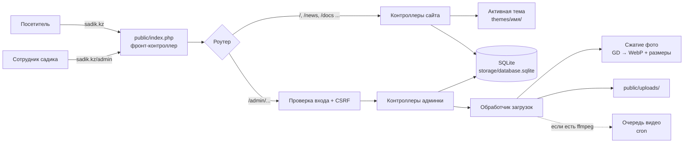
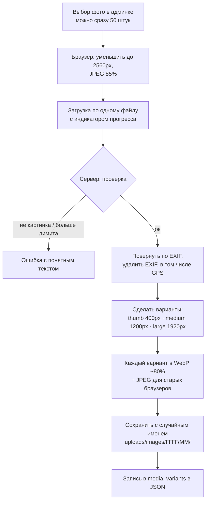

# Архитектура: сайт детского сада + админка

Версия 1 — для одного садика. Ядро сразу делается так, чтобы потом его можно было копировать другим садикам и менять только тему оформления.

---

## 1. Цели и ограничения

**Что должно быть**
- Публичный сайт: все разделы, нужные для аттестации, плюс новости, документы, фото и видео.
- Админка с входом по логину и паролю: всё содержимое сайта редактируется без программиста.
- Автоматическое сжатие фото, ограничение и (по возможности) сжатие видео.
- Сменные темы оформления: одна админка, разный дизайн.
- Дальше: казахский и русский языки, версия для слабовидящих.

**Ограничения**
- Сайт на домене `.kz` должен работать на сервере в Казахстане → ставим на обычный казахстанский хостинг (PS.kz, Hoster.kz и т. п.).
- На таком хостинге обычно есть только **PHP + MySQL/SQLite**, нет Node.js, нет `ffmpeg`, есть лимиты на размер загружаемого файла.
- Работать с сайтом будут воспитатели и методисты → админка должна быть максимально простой.

---

## 2. Технологии

| Часть | Выбор | Почему |
|---|---|---|
| Язык сервера | **PHP 8.1+** | Есть на любом хостинге в РК |
| База данных | **SQLite** (один файл) | Не нужно создавать БД в панели хостинга; копия сайта = копия папки. Можно переключить на MySQL через конфиг |
| Доступ к БД | PDO, только подготовленные запросы | Защита от SQL-инъекций |
| Шаблоны | Чистый PHP с функцией экранирования `e()` | Без зависимостей, работает везде |
| Сжатие фото | **GD** (или Imagick, если есть) | Расширения есть на любом хостинге |
| Сжатие фото до загрузки | JavaScript в браузере (canvas) | Фото с телефона 8–12 МБ → 0,5–1 МБ ещё до отправки; обходит лимит хостинга |
| Видео | YouTube-ссылки + загрузка MP4; сжатие через `ffmpeg`, только если есть VPS | см. раздел 6 |
| Редактор текста | Лёгкий WYSIWYG (Quill), HTML чистится на сервере | Привычно для пользователей, безопасно |
| Фронтенд админки | HTML + немного JS, без сборки | Нечего ломать, не нужен Node.js |
| Зависимости | Без Composer на хостинге (всё лежит в проекте) | Установка = загрузить папку |

---

## 3. Общая схема



---

## 4. Структура папок

```
sadik/
├── public/                  ← корень сайта (document root)
│   ├── index.php            ← единая точка входа
│   ├── .htaccess            ← красивые URL, заголовки безопасности
│   ├── assets/admin/        ← CSS/JS админки
│   └── uploads/             ← фото, видео, документы (PHP тут запрещён)
│       ├── images/2026/11/  ← оригинал не хранится, только сжатые версии
│       ├── videos/
│       └── docs/
├── app/
│   ├── Core/                ← Router, Database, Auth, Csrf, View, Session,
│   │                          Validator, Uploader, ImageProcessor, Sanitizer
│   ├── Controllers/
│   │   ├── Site/            ← Home, News, Documents, Gallery, Video, Page, Contacts
│   │   └── Admin/           ← Dashboard, News, Documents, Media, Albums, Videos,
│   │                          Staff, Groups, Pages, Settings, Users, Backup
│   ├── Models/              ← по одной на таблицу
│   └── helpers.php          ← e(), url(), asset(), t() (перевод)
├── themes/
│   ├── solnyshko/           ← первая тема (по текущему лендингу)
│   │   ├── theme.json       ← название, цвета по умолчанию, превью
│   │   ├── layout.php
│   │   ├── home.php, news-list.php, news-item.php, documents.php,
│   │   │   gallery.php, album.php, videos.php, page.php, contacts.php
│   │   └── assets/style.css
│   └── official/            ← вторая тема (строгая) — позже
├── admin-views/             ← шаблоны админки (общие для всех тем)
├── migrations/              ← SQL-файлы схемы БД по версиям
├── storage/                 ← закрыто от интернета
│   ├── database.sqlite
│   ├── logs/
│   ├── cache/
│   └── backups/
├── config/
│   ├── config.php           ← создаётся установщиком (пути, язык, режим)
│   └── config.example.php
└── install.php              ← мастер установки: создаёт БД и первого админа
```

Если хостинг не даёт сменить корень сайта на `public/`, папки `app/`, `storage/`, `config/` закрываются через `.htaccess` (`Require all denied`) — это предусмотрено.

---

## 5. Модель данных (таблицы)

| Таблица | Главные поля | Для чего |
|---|---|---|
| `users` | id, name, login, password_hash, role (`owner`/`editor`), is_active, last_login_at | Пользователи админки |
| `login_attempts` | ip, login, created_at | Защита от подбора пароля. Для лимита текущего пароля в профиле `ip` = `profile:<id пользователя>`, `login` = `password` |
| `remember_tokens` | id, user_id, selector, token_hash, prev_hash, rotated_at, expires_at, last_used_at | «Запомнить меня»: в БД только SHA-256 validator; `prev_hash`/`rotated_at` — прошлый хэш, действует 10 с после ротации (параллельные вкладки) |
| `settings` | key, value (JSON) | Название, контакты, логотип, тема, цвета, соцсети, часы работы, лицензия |
| `pages` | id, slug, title, body, sort, is_published | Статичные разделы: «О нас», «Программа», «Режим дня», «Питание», «Условия» |
| `news` | id, slug, title, excerpt, body, cover_media_id, status (`draft`/`published`), published_at, author_id | Новости и объявления |
| `news_media` | news_id, media_id, sort | Фото внутри новости |
| `media` | id, type (`image`/`video`/`file`), original_name, path, mime, size, width, height, variants (JSON), alt, status (`ready`/`processing`/`failed`) | Единая медиатека |
| `albums` | id, slug, title, description, cover_media_id, event_date, is_published | Фотоальбомы (праздники, занятия) |
| `album_media` | album_id, media_id, sort | Фото в альбоме |
| `videos` | id, title, source (`youtube`/`upload`), url, media_id, poster_media_id, is_published | Видео |
| `document_categories` | id, title, sort | «Аттестация», «Нормативные», «Отчёты», «Для родителей» |
| `documents` | id, category_id, title, media_id, doc_date, valid_until, checklist_key, is_published | Документы (PDF, DOCX, XLSX) |
| `attestation_checklist` | key, title, is_required | Список документов, обязательных для аттестации |
| `staff` | id, full_name, position, category, education, experience_years, photo_media_id, sort | Педагоги и сотрудники |
| `groups` | id, name, age_range, children_count, teacher_ids, sort | Возрастные группы |
| `achievements` | id, year, title, description, media_id | Достижения |
| `reviews` | id, author, text, is_published | Отзывы родителей |
| `audit_log` | user_id, action, entity, entity_id, created_at | Кто и что изменил |

**Языки (этап 2).** Текстовые поля, которые надо переводить, хранятся в таблицах `*_translations` (`entity_id`, `lang`, `title`, `body`). Структура закладывается сразу, чтобы потом не переделывать.

---

## 6. Медиа: загрузка и сжатие

### 6.1 Фото



- Обычный результат: фото с телефона **10 МБ → ~150–300 КБ** (large WebP), миниатюра ~20 КБ.
- Сайт показывает фото через `<picture>` + `srcset` + `loading="lazy"` → браузер сам берёт нужный размер.
- **Удаление EXIF обязательно:** в фото с телефона записаны координаты, а на фото дети.
- Оригинал не хранится (экономия места). Опция в настройках — «хранить оригиналы».
- Перед удалением фото проверяется, не используется ли оно в новости или альбоме.

### 6.2 Видео

На обычном хостинге нет `ffmpeg`, поэтому сжимать видео на сервере нельзя. Три способа, по порядку:

| Способ | Как | Когда |
|---|---|---|
| **1. YouTube (основной)** | Видео загружается на канал садика (можно «доступ по ссылке»), в админку вставляется ссылка | Всегда. Ноль нагрузки на хостинг, YouTube сам сжимает и адаптирует под скорость интернета |
| **2. Загрузка MP4 на сайт** | Короткие ролики до ~100 МБ, загрузка частями (chunked), сервер проверяет формат, админка подсказывает, как уменьшить | Если YouTube нельзя использовать |
| **3. Сжатие на сервере** | Если сайт на VPS и есть `ffmpeg`: файл ставится в очередь, cron сжимает в H.264 720p + делает обложку, статус «обрабатывается → готово» | Автоматически включается, если установщик найдёт `ffmpeg` |

Видео на сайте не загружается целиком сразу: сначала показывается только обложка (`preload="none"`), для YouTube — лёгкий плеер, который подгружается по клику.

### 6.3 Документы

- Разрешены: PDF, DOC/DOCX, XLS/XLSX, PPT/PPTX, JPG/PNG (сканы). Лимит настраивается, по умолчанию 20 МБ.
- PDF открываются прямо в браузере, остальные скачиваются.
- Документ можно привязать к пункту чек-листа аттестации и указать срок действия → на главной админки видно, какой документ скоро истекает.

---

## 7. Публичный сайт

| URL | Страница |
|---|---|
| `/` | Главная: приветствие, цифры, последние новости, ближайшие события, быстрые ссылки |
| `/o-nas`, `/programma`, `/rezhim`, `/pitanie` … | Статичные разделы из `pages` |
| `/pedagogi` | Педагоги с фото, категорией, стажем |
| `/gruppy` | Возрастные группы |
| `/novosti`, `/novosti/{slug}` | Список новостей с постраничным выводом, страница новости |
| `/fotogalereya`, `/fotogalereya/{slug}` | Альбомы и просмотр фото на весь экран |
| `/video` | Видео |
| `/dokumenty` | Документы по категориям |
| `/dostizheniya` | Достижения |
| `/kontakty` | Контакты, карта (код 2ГИС/Яндекс вставляется в настройках) |
| `/sitemap.xml` | Для поисковиков |

- Адаптивность для телефона, тёмная тема.
- SEO: `title`/`description` для каждой страницы, Open Graph (красивая карточка при отправке ссылки в WhatsApp/Telegram).
- **Версия для слабовидящих** (часто требуется у государственных организаций): кнопка в шапке → крупный шрифт, высокий контраст, без анимаций.
- Кэширование: страницы сайта кэшируются в `storage/cache`, сброс — автоматически при любом изменении в админке.

---

## 8. Админка

**Вход:** `sadik.kz/admin` (адрес можно сменить в конфиге).

| Раздел | Что можно делать |
|---|---|
| **Главная (дашборд)** | Чек-лист аттестации: ✅ загружено / ❌ нет / ⚠️ истекает. Последние новости, место на диске |
| **Новости** | Создать, редактировать, черновик/опубликовать, отложенная публикация, обложка, фото внутри, предпросмотр |
| **Документы** | Загрузить файл, выбрать категорию, привязать к чек-листу, срок действия, порядок (перетаскиванием) |
| **Фотогалерея** | Альбомы, массовая загрузка перетаскиванием, сортировка, подписи, выбор обложки |
| **Видео** | Вставить ссылку YouTube или загрузить MP4 |
| **Медиатека** | Все файлы в одном месте, поиск, где файл используется, удаление |
| **Разделы сайта** | Тексты страниц «О нас», «Программа» и т. д. |
| **Педагоги / Группы / Достижения / Отзывы** | Простые списки с формами |
| **Настройки** | Название, логотип, контакты, карта, соцсети, **тема оформления и цвета**, языки |
| **Пользователи** (только `owner`) | Добавить сотрудника, роль, сбросить пароль, заблокировать |
| **Резервная копия** (только `owner`) | Скачать архив: база + файлы. Автокопия базы раз в сутки |
| **Журнал** (только `owner`) | Кто и что менял |

**Роли:**
- `owner` (заведующая / ответственный) — всё.
- `editor` (воспитатель, методист) — новости, фото, видео, документы. Без пользователей, настроек и резервных копий.

---

## 9. Безопасность

- Пароли: `password_hash()` (bcrypt/argon2id), минимум 8 символов.
- Защита от подбора: 5 неудачных попыток по паре (IP, логин) или 20 с одного IP → блок на 15 минут. Попытка занимается в БД под `BEGIN IMMEDIATE` до проверки пароля (параллельные запросы не обходят лимит). Тот же лимит (5 попыток, 429) действует на ввод текущего пароля в профиле.
- «Запомнить меня»: токен selector+validator, в БД только хэш, ротация при каждом использовании; предъявлен ни текущий, ни прошлый (окно 10 с) validator — считается кражей: удаляются все токены пользователя и завершаются его сессии (`auth_version`).
- Сессии: cookie `HttpOnly`, `Secure`, `SameSite=Lax`, новый ID после входа, выход через 2 часа бездействия.
- CSRF-токен в каждой форме админки.
- Все SQL-запросы — подготовленные (PDO).
- Весь вывод экранируется; HTML из редактора пропускается через белый список тегов.
- Загрузки: проверка реального типа файла (`finfo`), белый список расширений, случайные имена, **SVG и любые скрипты запрещены**, фото перекодируются (это уничтожает вредоносную начинку), в `uploads/` выполнение PHP запрещено.
- Заголовки: `Content-Security-Policy`, `X-Frame-Options`, `X-Content-Type-Options`, `Referrer-Policy`.
- Только HTTPS (бесплатный сертификат Let's Encrypt в панели хостинга).
- `install.php` удаляется / блокируется после установки.

---

## 10. Темы оформления

- Тема = папка в `themes/` с шаблонами, CSS и `theme.json`.
- Все темы получают **одни и те же данные** → любую тему можно включить в любой момент без потери содержимого.
- В `theme.json` описаны настройки, которые меняются в админке без программиста: основной цвет, второй цвет, шрифт, картинка на главной, порядок блоков главной.
- Цвета передаются в CSS как переменные (`--primary` и т. д.).
- Новая тема для нового клиента = копия существующей + новые стили; админку трогать не нужно.

---

## 11. Требования к хостингу

- PHP 8.1 или новее.
- Расширения: `pdo_sqlite` (или `pdo_mysql`), `gd` с поддержкой WebP (или `imagick`), `fileinfo`, `mbstring`, `zip`.
- `upload_max_filesize` и `post_max_size` ≥ 64 МБ (для видео — больше, но благодаря загрузке частями хватит и меньшего).
- 2–5 ГБ диска для начала (фото сжимаются, видео лучше на YouTube).
- Cron (для автокопий и, если есть `ffmpeg`, для очереди видео).
- SSL-сертификат.

---

## 12. План работ

| Этап | Что делаем | Результат |
|---|---|---|
| **0. Каркас** | Структура папок, роутер, подключение к БД, миграции, `install.php`, конфиг | Пустой сайт открывается, установщик создаёт БД и админа |
| **1. Админка: основа** | Вход/выход, сессии, CSRF, защита от подбора, роли, макет админки, смена пароля | Можно войти в админку |
| **2. Настройки и разделы** | Настройки сайта, страницы, педагоги, группы, достижения, отзывы | Всё содержимое лендинга редактируется |
| **3. Тема «Солнышко»** | Перенос текущего лендинга в тему, все страницы сайта | Сайт показывает данные из БД |
| **4. Медиа и фото** | Загрузчик, сжатие в браузере и на сервере, WebP, варианты, медиатека, альбомы | Фотогалерея работает |
| **5. Новости** | CRUD новостей, редактор, обложки, черновики, отложенная публикация | Новости работают |
| **6. Документы + чек-лист** | Категории, загрузка, чек-лист аттестации на дашборде, сроки | Раздел документов и контроль аттестации |
| **7. Видео** | YouTube, загрузка MP4 частями, очередь `ffmpeg` (если есть) | Раздел видео |
| **8. Надёжность** | Резервные копии, журнал действий, кэш, sitemap, заголовки безопасности, версия для слабовидящих | Готово к сдаче |
| **9. Установка** | Инструкция «новый садик за 15 минут», проверка на реальном хостинге | Можно продавать |
| **10. Казахский язык** | Переводы интерфейса сайта и полей контента | Сайт на двух языках |

Этапы 0–6 — это минимальная версия, которую уже можно показывать на аттестации.

---

## 13. Что нужно решить до начала

1. **Языки:** сразу kk + ru или сначала только ru (структура под второй язык заложена в любом случае)?
2. **Видео:** согласны, что основной способ — YouTube, а загрузка на сайт — для коротких роликов?
3. **Хостинг:** есть ли уже конкретный хостинг? Тогда проверю требования под него.
4. **База:** SQLite по умолчанию (проще копировать) — подходит?
